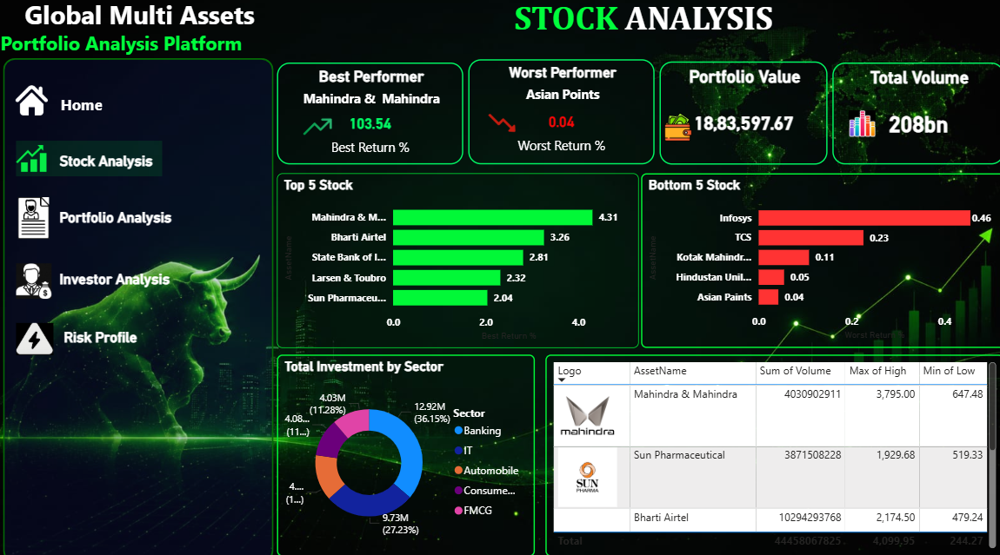

<h1 align='center'> Global Multi Assets Market Intelligence </h1>

<p align="center">
  
  
  
  
</p>

A modern **Power BI Business Intelligence Dashboard** designed to analyze investment portfolios across **Stocks and Cryptocurrencies**. This project provides a complete view of portfolio performance, investor behavior, market trends, asset allocation, and risk distribution using an interactive multi-page dashboard.

---

## Project Overview

Managing investments across multiple asset classes requires continuous monitoring of portfolio performance, market trends, investor activity, and risk exposure.

This dashboard transforms raw financial transaction data into actionable business insights by combining advanced Power BI visualizations, DAX measures, and interactive filtering.

The solution is divided into six analytical modules covering every major aspect of portfolio management.

---

## Business Objective

Stock market investors and analysts face challenges related to:

- Identifying top-performing stocks
- Monitoring portfolio performance
- Analyzing stock returns
- Comparing trading volumes
- Understanding investment risk
- Identifying underperforming stocks
- Making data-driven investment decisions

---

## Dataset Information

The project uses stock market data containing information related to:

- Stock prices
- Companies
- Sectors
- Trading activity
- Trading volume
- Portfolio holdings
- Investment values
- Returns
- Risk indicators
- Market performance

---

### Dataset Characteristics

- Historical stock market records
- Multiple companies
- Multiple sectors
- Daily stock prices
- Trading volume
- Portfolio information
- Return metrics
- Risk metrics
- Market performance indicators

---

## Dashboard Features

- Executive Summary
- KPI Cards
- Stock Price Trend
- Market Capitalization Analysis
- Trading Volume Analysis
- Top 10 Gainers
- Top 10 Losers
- Interactive Filters & Slicers
- Assets-wise performance Analysis

---

# Dashboard Pages

### 1. Home

Provides a high-level overview of the complete investment portfolio.

**Features**

- Total Assets
- Total Investors
- Total Investment
- Portfolio Value
- Overall ROI
- Interactive Navigation
- Company & Cryptocurrency Overview

---

### 2. Stock Analysis

Comprehensive analysis of stock investments.

**Includes**

- Best Performing Stock
- Worst Performing Stock
- Total Portfolio Value
- Total Trading Volume
- Total Listed Stocks
- Stock Price Trend
- Top Performing Stocks
- Trading Volume Analysis
- Sector Distribution

---

### 3. Crypto Analysis

Dedicated dashboard for cryptocurrency investments.

**Includes**

- Best Performing Cryptocurrency
- Worst Performing Cryptocurrency
- Crypto Portfolio Value
- Trading Volume
- Price Trend
- Top Performing Cryptocurrencies
- Portfolio Allocation
- Buy vs Sell Analysis

---

### 4. Portfolio Analysis

Provides complete portfolio performance across all asset classes.

**Includes**

- Total Investors
- Total Investment
- Average Investment per Investor
- Total Transactions
- Average Brokerage
- Asset Allocation
- Sector Allocation
- Top Investors
- Buy vs Sell Investment
- Investment by Asset Type

---

### 5. Investor Analysis

Analyzes investor behavior and investment patterns.

**Includes**

- Total Investors
- Total Investment
- Average Investment
- Total Transactions
- Average Brokerage
- Investment Trend
- Risk Profile Distribution
- Top Investors
- Investment by Risk Profile

---

### 6. Risk Profile

Analyzes portfolio exposure based on investor risk appetite.

**Includes**

- Aggressive Investors
- Moderate Investors
- Conservative Investors
- Total Investment
- Investment by Risk Profile
- Risk Profile vs Asset Type Matrix
- Top Investors
- Investor Distribution
- City-wise Investor Distribution

---

# Repository Structure

```
Global-Multi-Asset-Market-Intelligence/
│
├── 01_raw_data/
│   ├── Dim_Investor
│   ├── Dim_Transaction
│   ├── Dim_Asset
│   ├── Dim_Date
│   └── Fact_Market_Data
│
├── 02_powerbi_report/
│   └── Global_Multi_Asset_Market_Intelligence.pbix
│
├── 03_documentation/
│   ├── Business_Requirement_Data_Dictionary.txt
│
├── assets/
│   ├── dashboard_preview.png
│   └── project_screenshots/
│
├── .gitignore
└── README.md
```

---

# Dashboard Features

- Interactive Navigation
- Multi-page Dashboard
- Dynamic KPI Cards
- Cross Filtering
- Slicers
- Drill Down
- Professional UI
- Custom Background Design
- Responsive Layout
- Business-Oriented Visualizations

---

# Key KPIs

- Portfolio Value
- Total Investment
- Overall ROI
- Total Investors
- Total Transactions
- Average Brokerage
- Best Performer
- Worst Performer
- Trading Volume
- Asset Allocation
- Sector Distribution
- Buy vs Sell Investment
- Risk Distribution

---

# Data Model

The project follows a **Star Schema**.

### Fact Tables

- Fact_Stocks
- Fact_Crypto
- Fact_Transactions

### Dimension Tables

- Dim_Date
- Dim_Assets
- Dim_Investors

---

# Technologies Used

- Microsoft Power BI
- Power Query
- DAX
- Data Modeling
- Excel
- Star Schema
- Interactive Dashboard Design

---

# Power BI Skills Demonstrated

- Data Cleaning
- Data Transformation
- Data Modeling
- Relationship Management
- DAX Measures
- Calculated Columns
- KPI Design
- Advanced Visualizations
- Dynamic Filtering
- Dashboard Navigation
- Business Storytelling

---

# Dashboard Preview

### Home Page


### Stock Analysis


### Crypto Analysis


### Portfolio Analysis


### Investor Analysis 


### Risk Profile


---

# Future Improvements

- Live Stock Market API Integration
- Live Cryptocurrency Price Integration
- Portfolio Optimization
- Sharpe Ratio
- Beta Analysis
- Value at Risk (VaR)
- Monte Carlo Simulation
- Power BI Service Deployment
- Mobile Dashboard

---

# Author

**Rohini Bhaje**

Email: **bhajerohini@gmail.com**

GitHub: **https://github.com/Rohinibhaje69-cloud**

---
